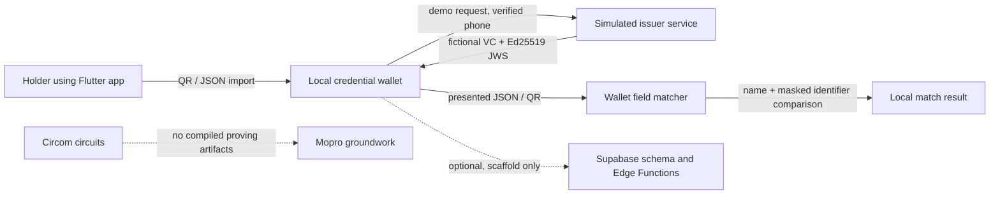
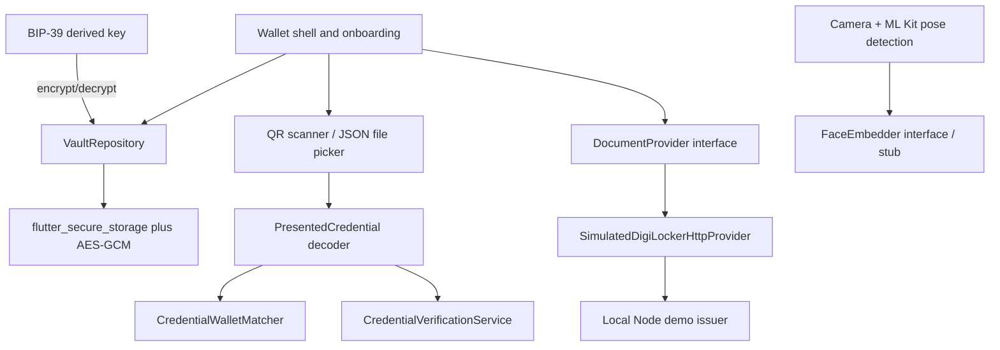

# MatchID architecture

## System context



## Flutter component map



## Onboarding

```mermaid
sequenceDiagram
  actor Holder
  participant OTP as MockOtpService
  participant Face as Face capture
  participant Wallet as Local encrypted wallet
  Holder->>OTP: Enter +91 phone, code 1234
  OTP-->>Holder: Demo verification (visible banner)
  Holder->>Face: Follow guided LEFT, RIGHT, FRONT pose challenge
  Face-->>Holder: Face presence/movement result; no identity match claim
  Holder->>Wallet: Choose wallet settings and confirm two mnemonic words
  Wallet-->>Holder: Save wallet state locally and unlock
```

## Credential intake and matching

1. Holder scans a QR or selects a DigiLocker JSON export, or explicitly requests a fictional demo document.
2. The decoder accepts JSON/JWS and extracts a credential object. Plain JSON is untrusted and is never called issuer-verified.
3. A demo issuer JWS is checked with a configured Ed25519 trust key. The app checks expiry and signature.
4. The wallet matcher compares the presented credential's name and masked identifier suffix against the wallet name and locally held credential claims.
5. The Verify screen reports wallet-field matching and issuer-signature status separately. Neither is a ZK proof.

## Selective-disclosure proof status

The planned QR proof flow is not active. Native Mopro assets are not integrated into the wallet shell, compiled circuit artifacts are absent, and no proof QR is issued. Retained legacy screens are not exposed in navigation. The server-signed attestation implementation is a demo alternative; it is an attestation, not zero knowledge.

## Data model

The approved remote schema is described in [DATABASE.md](DATABASE.md). The local store now separates an Identity record from Wallet records, encrypts wallet names and credential vault contents with AES-GCM using the BIP-39-derived wallet key, and provides wallet switching. On the next verified wallet onboarding, legacy single-wallet credentials are copied into Wallet #1 and re-encrypted before the old local keys are removed. Face embeddings remain null because `FaceEmbedder` is a stub. The local phone hash uses a device-local pepper; only the backend can create the cross-account server-peppered phone hash.
